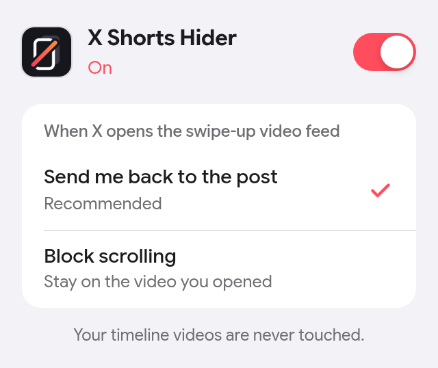
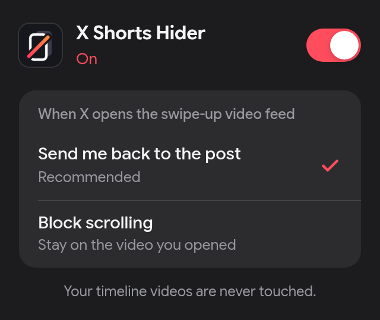

# Hidr

Tap a video on X and it can open a full-screen feed where swiping up plays recommended videos one after another. **Hidr stops that feed.** You still get the video you tapped. Everything else on X, including videos in your timeline, works as usual.

  
  

## What it does

Click the toolbar icon to choose what happens when X opens the swipe-up video feed:

- **Send me back to the post** (recommended): you land on the post with the video instead of the feed.
- **Block scrolling**: you stay on the video you opened, but you can't swipe, scroll or arrow-key to the next one. You can still play, pause and seek, read replies, close the video, or go back.

The switch at the top turns it on or off. Changes apply to open X tabs right away.

## Privacy

It collects nothing. No analytics, no accounts, no network requests of its own. It only runs on x.com and twitter.com, and it stores just your two settings on your device. See [PRIVACY.md](PRIVACY.md).

## Install

- **Safari (Mac, iPhone, iPad):** coming to the App Store.
  After installing, turn it on in Safari's extension settings and allow it on x.com.
- **Chrome:** coming to the Chrome Web Store.

## Good to know

- You need to be signed in to X to see the swipe-up feed, so there's nothing to stop while signed out.
- X tests different designs on different accounts and is moving to a new web app. If the feed ever slips through with **Block scrolling**, switch to **Send me back to the post**, which only looks at the page address and keeps working.
- **Send me back to the post** works like pressing Back when X opened the feed for you, with no reload. If you open a feed link directly, it loads the post page.

## License

MIT. See [LICENSE](LICENSE).
